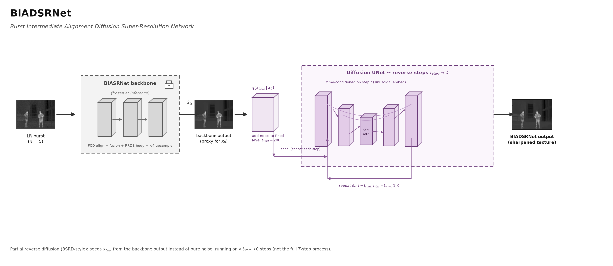
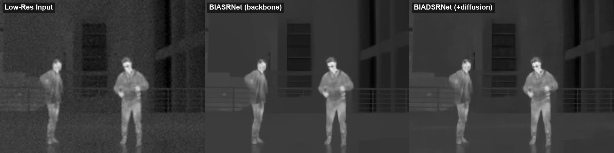
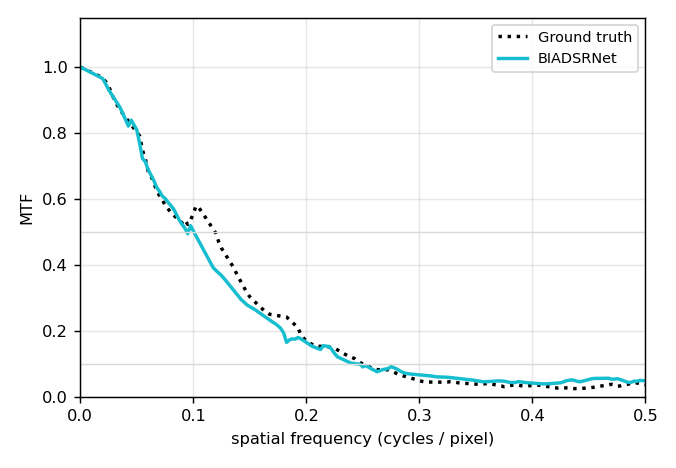

# BIADSRNet

**BIASRNet + Diffusion**: a conditional diffusion refinement stage on a frozen
[BIASRNet](https://github.com/meister1378/BiaSRNet) backbone, for sharper perceived texture.

- Reverse diffusion starts at t = 200 from the backbone output instead of pure noise
- Offline use: 201 UNet passes, ~179 s/frame on an RTX 4090
- Generated texture is not guaranteed to be physically real

## Architecture

<div align="center">
  
</div>

## Structure

```
.
├── model.py                           diffusion UNet, DDPM, BIADSRNet wrapper
├── biasrnet_model.py                  BIASRNet backbone
├── align.py                           Farneback pre-alignment
├── infer.py                           inference CLI
├── ckpt_crypto.py                     encrypted checkpoint loader
└── checkpoints/
    ├── biasrnet_bestPSNR.pth.enc      backbone
    └── diffrefine_final.pth.enc       diffusion stage
```

## Setup

```bash
pip install torch torchvision opencv-python numpy cryptography
```

## Checkpoints

The checkpoints are encrypted. Set the key (available from the author) before running:

```bash
export CKPT_KEY=<key>
```

## Inference

```bash
python infer.py --frames-dir /path/to/lr_frames \
    --backbone-ckpt ./checkpoints/biasrnet_bestPSNR.pth.enc \
    --diffusion-ckpt ./checkpoints/diffrefine_final.pth.enc --out-dir ./out
```

`--frames-dir`: consecutive low-resolution grayscale frames.

## Results

<div align="center">
  
</div>

## Spatial resolution (MTF)

ISO 12233 slanted-edge measurement on 23 real edges (median): FLIR-IVSR test HR frames, synthetically
degraded to 5-frame LR bursts, restored, and compared with the original HR frame.

<div align="center">
  
</div>

| | MTF50 (cy/px) | MTF10 (cy/px) | 10-90 % edge width | MTF50 / GT |
|---|---|---|---|---|
| Ground truth | 0.090 | 0.248 | 6.2 px | 1.00 |
| BIADSRNet | 0.093 | 0.223 | 6.0 px | 1.01 |

The output restores the resolution of the original frame.

## License

All rights reserved.

## Data

- [IRVAL](https://huggingface.co/datasets/zytlhy/IRVAL) (CC-BY-4.0)
- [OpenThermalAction](https://huggingface.co/datasets/issai/OpenThermalAction) (MIT)
